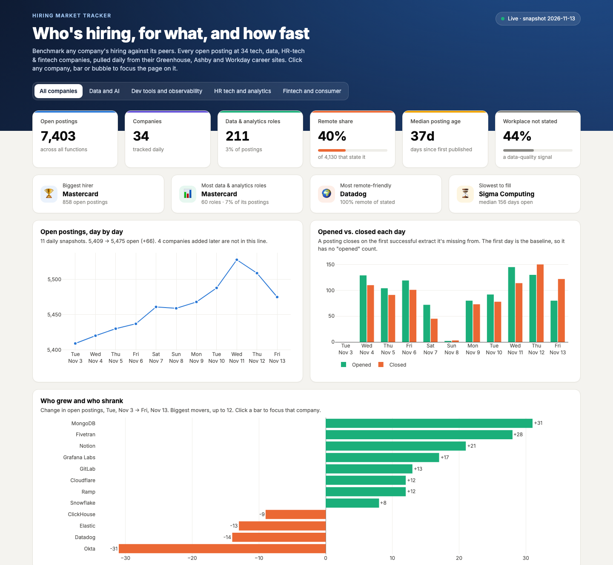

# Hiring Market Tracker

A hiring benchmark for talent acquisition and workforce planning teams. It answers three questions about a set of competing companies: where they are hiring, which functions are growing, and how long their roles stay open.

Companies publish every open role on public ATS job boards, but a board only shows what is open today. This project takes a full snapshot of 30 companies' Greenhouse and Ashby boards every day, loads the raw JSON into BigQuery, and uses dbt to track each posting from the day it appears to the day it closes. GitHub Actions runs it daily and republishes the dashboard, where any company can be compared with its industry group.

**Dashboard:** https://raghav-aggarwal-20.github.io/hiring-market-tracker/ (rebuilt after each daily run)



## What it shows (snapshot of 2026-11-12)

- 5,499 open postings across 30 companies in four industry groups: data and AI, dev tools and observability, HR tech and analytics, fintech and consumer. 115 are data and analytics roles (analyst, analytics engineer, data scientist, data engineer, BI).
- Median posting age is 45 days. Sigma Computing's median is 155 days.
- Of the 3,566 postings that state a workplace, 40% are remote. 35% of postings don't state one at all; Elastic and Okta never do.

## First 10 days (2026-11-03 to 2026-11-12)

Ten daily snapshots, all 30 companies extracted successfully on every day.

- 6,257 distinct postings seen. 848 opened after the first day and 758 closed, so open postings rose from 5,409 to 5,499 (+1.7%).
- Postings go up on weekdays. The two Wednesday snapshots found 129 and 145 new postings; the Sunday snapshot found 2.
- Roles that closed had been open a long time. The median closed posting had been listed for 57 days, and 29% for more than 90. Only 43 postings opened and closed inside the 10 days.
- Steady totals hide a lot of churn. Dev tools and observability opened 335 postings and closed 333, ending flat (2,120 to 2,122). Fintech and consumer grew 3.9% and data and AI 2.6%.
- Sales grew the most of any function (1,644 to 1,684, +40). Engineering slipped from 1,855 to 1,842.
- Fastest growing: Grafana Labs (123 to 155) and Fivetran (161 to 189). Okta shrank the most (392 to 367, with 73 closed against 48 opened), followed by Datadog (398 to 383).

## Architecture

```
Greenhouse Job Board API ─┐
                          ├─ extract/ (Python) ── raw.job_postings      (JSON payload, partitioned by snapshot_date)
Ashby Posting API ────────┘                    └─ raw.extract_runs      (one row per company per run: status, count, error)
                                                          │
                                                   dbt (analytics dataset)
          staging (views)        stg_greenhouse__postings, stg_ashby__postings, stg_extract_runs
          intermediate (views)   unioned, classified, posting lifecycle, company extract days
          marts (tables)         dim_company, dim_posting, fct_company_daily, fct_postings_current
          reporting (tables)     rpt_postings_current, rpt_company_summary, rpt_company_daily, rpt_pipeline_health
                                                          │
                              ┌───────────────────────────┴──────────────────────────┐
                    dashboard/build.py → GitHub Pages                     Google Data Studio report
```

| Layer | Tooling |
|---|---|
| Extract and load | Python 3.12, `requests` with retries, BigQuery load jobs. Each day's partition is overwritten, so re-running a day is safe. |
| Warehouse | BigQuery. Raw table partitioned by `snapshot_date`, clustered by `company_slug`, payload kept as `JSON`. |
| Transform and test | dbt Core 1.12 and dbt-bigquery: 15 models, 3 seeds, 67 tests including one unit test |
| Orchestration | GitHub Actions on a daily cron plus manual dispatch |
| Auth | Service account `hmt-pipeline` with BigQuery Job User on the project and Data Editor on the `raw` and `analytics` datasets only |
| Dashboards | Static Plotly page built from the `rpt_` tables, plus a Google Data Studio (formerly Looker Studio) report |
| Cost guard | Every dbt and dashboard query is capped at 1 GB billed |

## How a posting is tracked

The job-board APIs only return what is open right now, so history comes from storing a full snapshot every day.

- **Key:** `ats | company_slug | posting_id`.
- **First seen / last seen:** the first and last snapshot that contained the posting.
- **Closed:** the first day the company was extracted successfully and the posting was missing. If a company's API call fails, its postings stay open, so an outage never looks like a hiring freeze.
- **Posting age:** days since the ATS publish date (`first_published` on Greenhouse, `publishedAt` on Ashby). This is available for every posting on day one, before any history exists.

Classification is rule-based and lives in seeds and macros, so it can be reviewed and tested:

- **Data role:** title phrases such as "data analyst" or "analytics engineer", split into six families. Business analyst titles are tagged but not counted. Full definitions: [`docs/metric_definitions.md`](docs/metric_definitions.md).
- **Function:** prioritized regex rules in `function_rules.csv`, applied to the title first and then to the department. 1.7% of postings end up as "other".
- **Workplace:** the ATS field if present, otherwise the location text, otherwise "not stated".
- **Usable pay:** USD, annual, between $20K and $2M, min ≤ max, and not a sales on-target-earnings range.

## Data quality

| Check | Severity | Catches |
|---|---|---|
| Every active company extracted today | error | a board token that broke or an API that changed |
| Open postings fell by more than half since the last good day (boards with 10+ postings) | warn | a silent partial extract |
| More than 25% of postings classified "other" | warn | rules drifting as titles change |
| 24 hand-labeled tricky titles still classify correctly | error | regressions in the regex rules |
| Source freshness on `raw.job_postings` | warn at 30h, error at 48h | the daily run not happening |
| Unit test: a posting closes only after a successful extract | error | the lifecycle logic |

I tested these by breaking them on purpose. In throwaway datasets I broke one board token and inflated another company's history. The completeness test failed and named the company, its postings stayed open, and the drop test warned. That run also exposed a bug in my own setup: the completeness test read the `companies` seed, so when it failed, dbt skipped the downstream dashboard tables for every company. It now reads only `fct_company_daily`, which has nothing downstream of it.

## Limitations

- **Job-board API, not Harvest.** These public APIs cover postings only. Applications, candidates, stages, and offers need Greenhouse's authenticated Harvest API. [`docs/harvest_extension.md`](docs/harvest_extension.md) sketches how the model would extend.
- **No Workday.** Most large enterprises post through Workday, which has no comparable public API, so the company list leans toward tech.
- **Reposted roles.** A posting that is taken down and republished under a new ID counts as a close plus a new open.
- **Reopened postings.** If the same ID disappears and comes back, it is treated as one continuous posting; `days_seen` shows the gap.
- **Inactive companies.** Setting `is_active = false` in the seed removes a company from current reporting without closing its postings.
- **Short history.** Ten days show the weekly rhythm but not a trend, and time-to-close is only measurable for postings opened after 2026-11-03. Until more weeks pass, posting age comes from the ATS publish date, which resets if a company reposts.

## Run it yourself

```bash
uv venv --python 3.12 && source .venv/bin/activate
pip install -r requirements.txt
gcloud auth application-default login          # or set GOOGLE_APPLICATION_CREDENTIALS
python -m extract                              # pull today's postings into raw
dbt deps --project-dir dbt --profiles-dir dbt
dbt build --project-dir dbt --profiles-dir dbt
python -m dashboard.build                      # writes dashboard/site/index.html
```

Settings come from environment variables with defaults: `GCP_PROJECT_ID` (hiring-market-tracker), `RAW_DATASET` (raw), `DBT_DATASET` (analytics). Companies are listed in `dbt/seeds/companies.csv`.

## Repository layout

```
extract/            API clients, BigQuery loader, run log
dbt/                models, seeds, macros, singular tests
dashboard/          build.py + template.html (static Plotly page)
docs/               metric definitions, Harvest extension
.github/workflows/  daily.yml
```
